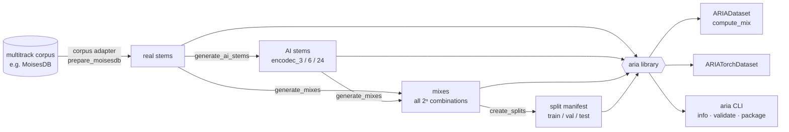

# ARIA

**Authentic vs Reconstructed Isolated Audio** is a Python library for building and loading hybrid music mixtures in which some stems are real and some are AI-reconstructed.

Starting from any multitrack corpus with isolated stems, ARIA reconstructs every stem with a neural codec, builds every real/AI combination of each song's stems as a mix, and labels each mix with which stems are AI (split manifests can also carry the AI energy ratio α from per-mix metrics). Use it to train and benchmark detectors of fully or partially AI-generated music.

The method is corpus- and codec-agnostic. The reference build, used in the [ISMIR 2026 paper](#citation), is [MoisesDB](https://github.com/moises-ai/moises-db) (240 songs) reconstructed with [Encodec](https://github.com/facebookresearch/encodec); the scripts generate 3, 6 and 24 kbps. ARIA ships code only: you build the dataset from your own copy of the corpus.



## Installation

```bash
git clone https://github.com/fergarciadlc/aria.git
cd aria
pip install -e .            # library: numpy, scipy, soundfile, tqdm
pip install -e ".[torch]"   # + PyTorch dataset
pip install -r requirements.txt   # everything, incl. dataset creation tools
```

Python 3.10+. Writing MP3 (dataset creation, `aria package -f mp3`) needs `ffmpeg` on `PATH`.

## Dataset layout

```
aria/
├── {track-uuid}/
│   ├── metadata.json                 # id, artist, name, genre, stems, provider
│   ├── stems/
│   │   ├── real/{stem}.wav
│   │   └── ai_generated/
│   │       ├── encodec_3/{stem}.mp3
│   │       ├── encodec_6/{stem}.mp3
│   │       └── encodec_24/{stem}.mp3
│   └── mixes/{codec}/
│       ├── U0/mix_S-empty.mp3        # all real
│       ├── U1/mix_S-0.mp3            # stem 0 is AI
│       ├── U2/mix_S-0-2.mp3          # stems 0 and 2 are AI
│       └── ...                       # each mix has a .json sidecar
└── splits/canonical_v1.jsonl         # train/val/test manifest
```

- **Stem indices** refer to the track's stem names in **alphabetical order** (`Track.stem_names`). For `bass, drums, guitar, vocals`, `mix_S-1` has AI drums.
- `U{k}` holds the C(n, k) mixes with exactly k AI stems; a track with n stems has 2ⁿ mixes per codec.
- **Audio:** 44.1 kHz stereo. AI stems and mixes are 256 kbps MP3. The reference build uses Encodec's *replicate* mode (44.1 kHz audio fed to the 48 kHz model unresampled); see [scripts/README.md](scripts/README.md).
- **Other corpora:** anything that can be written in this layout (a `metadata.json` with the stem names, plus `stems/real/`) works with every later step. `prepare_moisesdb.py` is the MoisesDB adapter; corpora such as MUSDB18 or Slakh need an equivalent.
- Mixes are optional on disk: the library computes any mix from the stems.

## Quick start

> Interactive version: [examples/quickstart.ipynb](examples/quickstart.ipynb).

```python
from aria import ARIADataset, MixSpec, compute_mix, get_or_compute_mix, get_stem_path, load_audio

dataset = ARIADataset("/path/to/aria")
track = dataset[0]                    # or dataset["<uuid>"], dataset.get_by_name("Artist")
track.stem_names                      # ['bass', 'drums', 'guitar', 'vocals']
rock = dataset.filter(genre="rock", min_stems=4)

# Stems
audio, sr = load_audio(get_stem_path(track, "vocals"))                                  # (2, N), 44100
audio, sr = load_audio(get_stem_path(track, "vocals", "ai_generated", codec="encodec_3"))

# Mixes: stems 0 and 2 AI-generated
spec = MixSpec(ai_indices=(0, 2), codec="encodec_3")
mix = get_or_compute_mix(track, spec)   # pre-computed file if present, else computed
mix = compute_mix(track, spec)          # always from stems
```

`generate_all_mix_specs(track.num_stems, codec)` lists all 2ⁿ specs, `MixSpec.from_filename("mix_S-0-2.mp3", codec)` parses a mix name.

## PyTorch

```python
from torch.utils.data import DataLoader
from aria import SplitManifest
from aria.torch import ARIATorchDataset, aria_collate_fn

manifest = SplitManifest("/path/to/aria/splits/canonical_v1.jsonl", dataset_root="/path/to/aria")
train = ARIATorchDataset(
    "/path/to/aria",
    manifest=manifest, split="train",   # pre-computed mixes; omit to compute every mix on the fly
    codec="encodec_3",
    segment_duration=5.0,               # random crops; eval_mode=True for center crops
    label_mode="binary",
)
loader = DataLoader(train, batch_size=32, shuffle=True, num_workers=4, collate_fn=aria_collate_fn)

for batch in loader:
    batch["audio"]   # (B, 2, T)
    batch["label"]   # (B,)
```

| `label_mode` | Label |
|---|---|
| `binary` | 0 = all real, 1 = any AI stem |
| `count` | number of AI stems |
| `ratio` | fraction of AI stems |
| `energy_ratio` | energy share of AI stems (manifest with energy metrics only) |

Without a manifest, `mix_sampling` picks the mixes per track: `all` (2ⁿ), `binary` (all-real and all-AI only) or `balanced` (one random mix per number of AI stems). Labels are imbalanced towards AI; `get_class_weights()` gives inverse-frequency weights for `binary`. Crops use torch's RNG, so call `torch.manual_seed()` for reproducible runs.

Splits assign whole tracks to train/val/test, so no song appears in two splits. Each manifest record carries `track_id`, `ai_indices`, `num_ai_stems`, `ai_stem_ratio`, `ai_energy_ratio`, `duration` and `mix_path`.

## Command line

```bash
aria info /path/to/aria --detailed     # tracks, codecs, genres
aria validate /path/to/aria            # every stem present for every codec
aria package -s /path/to/aria -o out/aria-tiny --tier tiny   # release subsets
```

`python -m aria …` works too.

## Building the dataset

Maintainer scripts in [`scripts/`](scripts/README.md) rebuild ARIA from MoisesDB (real stems → Encodec stems → mixes → splits) and package releases. Evaluation scripts for existing detectors are in [`evaluation/`](evaluation/README.md).

## Development

```bash
pip install -e ".[all]"
pytest
```

## Citation

If you use ARIA, please cite the ISMIR 2026 paper ([arXiv:2608.07285](https://arxiv.org/abs/2608.07285)):

```bibtex
@inproceedings{garciadelacruz2026howmuchai,
  title         = {How Much {AI} Is in This Track? Quantifying the Proportion
                   of {AI}-Generated Stems in Hybrid Music Mixtures},
  author        = {Garcia de la Cruz, Fernando and L{\'o}pez-Ayala, David and
                   Zinemanas, Pablo and Molina, Emilio and Rocamora, Mart{\'i}n},
  booktitle     = {Proceedings of the 27th International Society for
                   Music Information Retrieval Conference (ISMIR)},
  address       = {Abu Dhabi, UAE},
  year          = {2026},
}
```

## License

[MIT](LICENSE). The repository contains only code.

Stems and mixes you build with ARIA are derived from your source corpus and remain under its license. For MoisesDB that is [CC BY-NC-SA 4.0](https://creativecommons.org/licenses/by-nc-sa/4.0/) (non-commercial, share-alike).

The reference build uses [MoisesDB](https://github.com/moises-ai/moises-db) stems and [Encodec](https://github.com/facebookresearch/encodec).
